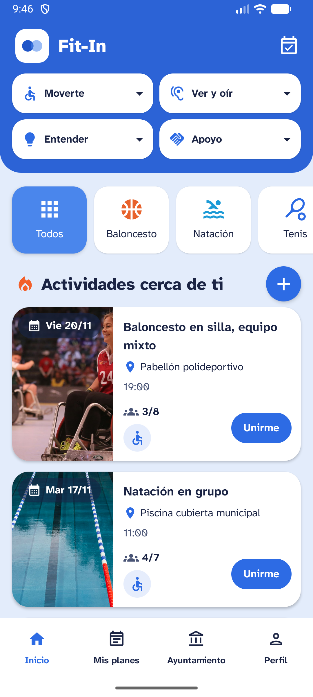
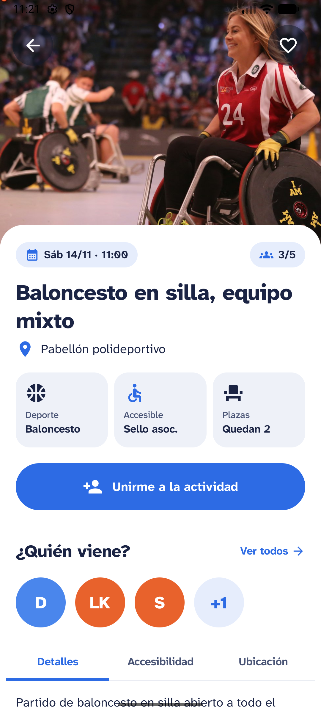
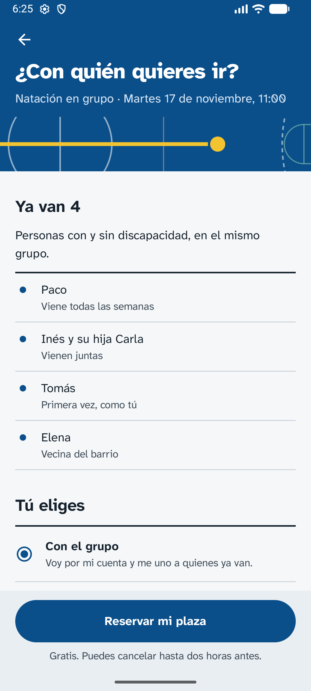
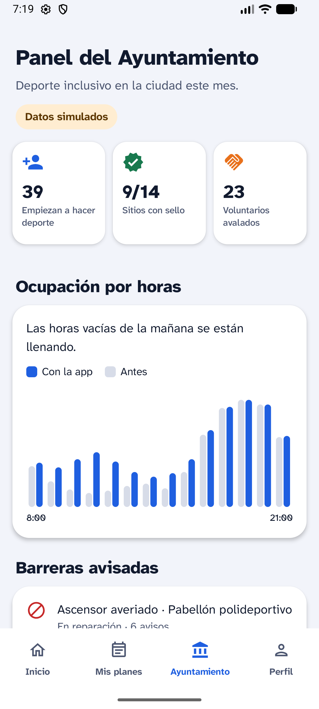

# Fit-In

**Deporte inclusivo en Marbella: actividad, sitio comprobado y compañía.**

🏆 **Primer puesto en la hackathon MarbellUp 2026**

---

> *Que ninguna persona con discapacidad en Marbella se quede sin hacer deporte por no tener con quién ni dónde.*

Fit-In empieza preguntándote **qué necesitas, nunca qué tienes**. Con eso te propone una actividad en un sitio cuya accesibilidad ha comprobado alguien (y se dice quién y cuándo) y un grupo con el que ir. Es deporte inclusivo, no separado: personas con y sin discapacidad en el mismo grupo.

  
  
  
  

## Qué hay en este repo

| | |
|---|---|
| 📱&nbsp;**[`app/`](app)** | App Android en Kotlin + Jetpack Compose. Recorre la historia de Lucía: indica sus necesidades, encuentra natación en grupo, ve quién lo ha comprobado, elige con quién ir y reserva. Incluye el **panel del Ayuntamiento** y la opción de crear actividades. |
| 🌐&nbsp;**[`web/`](web)** | `index.html`: la web del proyecto, con un móvil interactivo para probar la app. `presentacion.html`: la presentación que expusimos ante el jurado (se avanza con las flechas o la barra espaciadora). |
| 🎬&nbsp;**[`video/`](video)** | El reel de la historia de Lucía (`fit-in-reel-lucia.mp4`) y su proyecto de edición. |
| 🖼️&nbsp;**[`shots/`](shots)** | Capturas de la app durante su desarrollo. |
| 📄&nbsp;**[`PRODUCT.md`](PRODUCT.md)** | Usuarios, principios y alcance del producto. |

## Lo que es (y lo que no)

Fit-In es un **prototipo para la demo de la hackathon**, no una app terminada:

- ✅ El flujo principal se puede recorrer de principio a fin en el móvil.
- ✅ Diseño cuidado y pensado para la accesibilidad: tipografía Atkinson Hyperlegible, botones grandes y modo oscuro.
- ⚠️ **Todos los datos son de ejemplo**: las actividades, las personas y las cifras del panel municipal son inventadas y están en memoria. No hay backend.
- ⚠️ Faltan piezas de una app real: registro, chat, pagos, mapa completo e instalaciones reales del piloto.
- ⚠️ Algunas pantallas son solo maqueta y quedan detalles visuales sin pulir.

## Probarlo

**App:** abre el proyecto en Android Studio y ejecuta el módulo `app` (minSdk 26).

**Web y presentación:** abre `web/index.html` o `web/presentacion.html` en el navegador. No hace falta servidor.

## Créditos

Fotos de Unsplash y Wikimedia Commons; los autores y las licencias están en [`CREDITOS-FOTOS.md`](CREDITOS-FOTOS.md). La tipografía Atkinson Hyperlegible Next tiene licencia [OFL](OFL-AtkinsonHyperlegibleNext.txt).

Hecho con ❤️ en Marbella para MarbellUp 2026 por 
Javier Román Meléndez · Mario Cáceres Morales · Noa Ramos Ruiz · Noelia Sánchez Vilchez · Javier Romeo Enríquez de Salamanca

